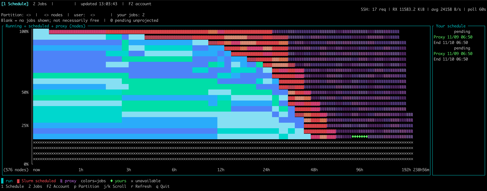

# sqtop

A read-only Slurm schedule explorer over SSH.

I'm building `sqtop` (_slurm-queue top_) to maintain my sanity while waiting for Slurm. I'd like to stop staring at the queue, wondering whether my job will start before the next meeting, and go prepare the update. Or forget about the job entirely until the meeting reminds me.

Refreshing the queue hasn't made it move faster so far. I have tried.



```
1: Tab: Schedule
2: Tab: Jobs
F2: Chagne Account
p: Switch Partition
j/k: Scroll
r: Refresh
q: Quit
```

`sqtop` keeps a low-bandwidth bridge to the HPC login node. It polls for a small snapshot and draws the schedule locally, so checking status stays light on the login server.

## Install

With Homebrew:

```sh
brew install skim0119/tap/sqtop
```

Or build from source with a Rust toolchain:

```sh
cargo install --locked --path .
```

Make sure Cargo's bin directory (normally `~/.cargo/bin`) is on your PATH. To update an existing installation, add `--force`.

## Run

```sh
sqtop user@host
sqtop --help
```

Pass an SSH alias or `user@host` to open the dashboard.

Use the same SSH alias or `user@host` you would pass to `ssh`. sqtop uses your OpenSSH configuration and authentication. No sqtop configuration file is needed.

## Contribution

Ideas and updates are welcome.

## Development

```sh
cargo fmt --all --check
cargo test --locked --all-targets
```
